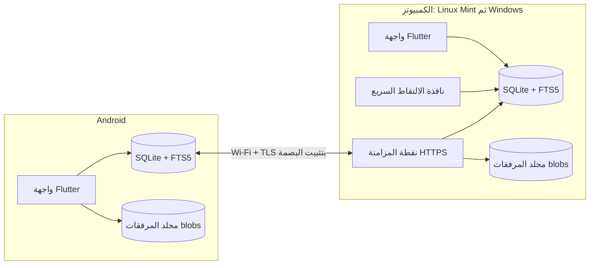

# TECHNICAL_SPEC.md — العقل الثاني (Second Brain)

**الإصدار:** 0.1 (مسودة للمراجعة)
**مبنية على:** `PRD_v0_2.md` + إجابات المالك + فحص عينة فعلية من Google Takeout
**الحالة:** مسودة — الأقسام المعلّمة بـ ⚠️ تعتمد على افتراضات أو على اختبارات (Spikes) لم تُنفّذ بعد

---

## 0. كيف تُقرأ هذه الوثيقة

- القرارات المعتمدة مكتوبة بصيغة الإلزام («يجب»).
- ما لم يُتحقق منه بعد مكتوب بصيغة الافتراض ومعلّم بـ ⚠️، وله بند في **قسم 18 (Spikes)** أو **قسم 21 (أسئلة وافتراضات)**.
- أسماء المكتبات المذكورة «مرشّحة» ويُتحقق من صيانتها وتوافقها مع إصدار Flutter الحالي وقت التنفيذ؛ لا تُعتمد أرقام إصدارات في هذه الوثيقة.

---

## 1. القرارات المعتمدة

| # | القرار | التفصيل |
|---|--------|---------|
| 1 | إطار العمل | Flutter لـ Android والكمبيوتر بقاعدة كود واحدة |
| 2 | أنظمة الكمبيوتر | Linux Mint (Cinnamon على X11) أولًا، ثم Windows لاحقًا دون إعادة بناء |
| 3 | التخزين | SQLite محلية على كل جهاز، دون PostgreSQL وبدون خادم Node.js منفصل |
| 4 | نمط التشغيل | Local-first: كل جهاز يعمل بمفرده كاملًا، والمزامنة اختيارية عبر Wi-Fi |
| 5 | المزامنة | نقطة مزامنة HTTPS **داخل تطبيق الكمبيوتر نفسه**، والهاتف هو من يبدأ الاتصال |
| 6 | حل التعارض | «آخر تعديل يفوز» على مستوى السجل، مع الاحتفاظ بآخر نسختين قديمتين للملاحظة |
| 7 | الاقتران | QR Code يحمل بصمة الشهادة وسرًّا مؤقتًا؛ لا تثبيت شهادات يدويًا |
| 8 | النص | Markdown داخل قاعدة البيانات، مع تصدير إلى ملفات `.md` |
| 9 | البحث | داخل التطبيق فقط (FTS5 مع تطبيع عربي)، ولا فهرسة لمحتوى الملفات أو المجلدات |
| 10 | مجلدات المشاريع والكورسات | ربط مسار مجلد بالمشروع/الكورس للفتح السريع، **على الكمبيوتر فقط ولا يُزامن** |
| 11 | مراجعة الدروس | إلغاء التكرار المتباعد؛ «السؤال» نوع معرفة مرتبط بدرس مع علامة «تمت مراجعته» |
| 12 | تقدم المشروع | تلقائي من المهام مع تعديل يدوي ومراحل (Milestones) |
| 13 | الجدول اليومي | يدوي مرن في الإصدار الأول، دون محرك جدولة |
| 14 | النسخ الاحتياطي | إلى مجلد محلي يحدده المستخدم، مع تصدير واستعادة تُختبر فعليًا، دون تشفير في الإصدار الأول |
| 15 | المستخدمون | مستخدم واحد مع أجهزة متعددة، مع تهيئة حقل `user_id` لتعدد المستخدمين مستقبلًا |
| 16 | اللغة | عربية فقط (RTL) مع إخراج النصوص إلى ملفات ترجمة (ARB) منذ البداية |

---

## 2. المبادئ الهندسية

1. **البساطة أولًا:** لا خدمة تُضاف دون حاجة مثبتة. مكوّن واحد (التطبيق) ما أمكن.
2. **الكتابة محلية دائمًا:** أي إضافة أو تعديل يُحفظ فورًا في SQLite المحلية؛ الشبكة لا تُعيق الحفظ أبدًا.
3. **الجاهزية للمزامنة منذ اليوم الأول:** معرّفات UUID، وساعة منطقية HLC، وسجل تغييرات، وسجلات الحذف (Tombstones) تُبنى في أول جدول وليس بعد ذلك.
4. **لا فقدان صامت للبيانات:** لا حذف نهائي مباشر، ولا استيراد يُعدّل الأصل، ولا استعادة دون نسخة أمان مسبقة.
5. **كل ما يتعلق بالنظام يُعزل:** كل ما يخص Linux/Windows/Android يقع خلف واجهات (Interfaces) في طبقة `platform/` كي لا يتسرب إلى بقية الكود.
6. **القابلية للاختبار:** منطق التطبيع والمزامنة والاستيراد والنسخ الاحتياطي كلها دوال/خدمات نقية قابلة للاختبار دون واجهة.

---

## 3. المعمارية



### 3.1 الأدوار

- **تطبيق الكمبيوتر:** يحتوي كل وظائف التطبيق، ويعمل في الخلفية (أيقونة في شريط النظام) لتشغيل الاختصار العام، ويستضيف نقطة المزامنة عند تفعيلها.
- **تطبيق Android:** يحتوي الوظائف نفسها (عدا ربط المجلدات والاستيراد في v1)، ويعمل مستقلًا، ويبدأ المزامنة بنفسه عند توفر الكمبيوتر.
- **لا يوجد خادم مركزي:** الكمبيوتر هو «المرجع» فقط في ترقيم التغييرات (`seq`) وليس شرطًا لتشغيل التطبيق يوميًا.

### 3.2 تغييرات ضرورية على PRD بسبب هذه المعمارية

- عبارة «قاعدة بيانات واحدة هي مصدر الحقيقة» تُستبدل بـ «لكل جهاز قاعدة محلية كاملة، وتتقارب القواعد عبر المزامنة».
- «الاحتفاظ بالمسودة عند تعذر الاتصال» لم يعد لازمًا في الحفظ العادي (الحفظ محلي دائمًا)، ويُستبدل بمؤشر حالة المزامنة، مع بقاء مسودة النافذة غير المحفوظة (انظر 9.6).

---

## 4. الحزمة التقنية (مرشّحات)

| الغرض | المرشّح | ملاحظة |
|-------|---------|--------|
| اللغة والإطار | Dart + Flutter (Android، Linux، Windows لاحقًا) | |
| قاعدة البيانات | SQLite عبر `drift` | هجرات (Migrations) منظمة، استعلامات آمنة الأنواع |
| البحث | SQLite FTS5 | يجب التأكد من توفر FTS5 في بناءات Android وLinux (Spike S4) |
| إدارة الحالة | Riverpod | |
| التنقل | go_router | |
| خادم المزامنة | `shelf` داخل التطبيق + `dart:io` `HttpServer.bindSecure` | |
| عميل المزامنة | `dart:io` `HttpClient` مع التحقق من بصمة الشهادة | لا يعتمد على سلسلة شهادات النظام |
| توليد الشهادة | مكتبة Dart خالصة (مثل `basic_utils`/`pointycastle`) | لا اعتماد على OpenSSL كي ينتقل لـ Windows (Spike S2) |
| اكتشاف الأجهزة | mDNS (مثل `nsd`) | مع بدائل: آخر عنوان معروف، ثم إدخال يدوي |
| الاختصار العام | `hotkey_manager` | X11 على Mint (Spike S1) |
| النافذة والأيقونة | `window_manager` + `tray_manager` | |
| قراءة النص المحدد (Linux/X11) | `xclip` (PRIMARY selection) | تبعية نظام تُعلن في حزمة `.deb` |
| عنوان النافذة النشطة (Linux/X11) | `xdotool` + `xprop` | |
| عرض Markdown | مكتبة نشطة الصيانة (مثل `markdown_widget`) | يُتحقق من الدعم الحالي وقت التنفيذ |
| اختيار الملفات والمجلدات | `file_picker` | |
| فتح مجلد بمدير الملفات | `url_launcher` (`file://`) مع بديل `xdg-open` | |
| QR | `qr_flutter` للإنشاء + `mobile_scanner` للقراءة | |
| ضغط ZIP | `archive` (قراءة تدفقية) | للنسخ الاحتياطي واستيراد Takeout |
| التجزئة | `crypto` (SHA-256) | |
| المعرّفات | `uuid` (النسخة v7 مرتبة زمنيًا) | |
| الاستقبال من «مشاركة» Android | مكتبة مشاركة نشطة أو Platform Channel | |
| التعبئة | Linux: `.deb` أو AppImage؛ Android: APK/AAB | |

---

## 5. نموذج البيانات

### 5.1 اصطلاحات عامة

كل جدول **متزامن** يحتوي الأعمدة التالية:

| العمود | النوع | الوصف |
|--------|-------|-------|
| `id` | TEXT PK | UUIDv7 |
| `user_id` | TEXT | القيمة الافتراضية `'local'`؛ محجوز لتعدد المستخدمين |
| `created_at` | INTEGER | ميلي ثانية UTC |
| `updated_at` | INTEGER | ميلي ثانية UTC (للعرض) |
| `hlc` | TEXT | الساعة المنطقية الهجينة (للفصل في التعارض، انظر 7.2) |
| `deleted_at` | INTEGER NULL | سجل الحذف (Tombstone) بدل الحذف الفعلي |

قواعد:

- **لا مفاتيح أجنبية صارمة (FOREIGN KEY) على الجداول المتزامنة.** تُخزَّن المعرّفات وتُفهرس، وتُعالج الإحالات اليتيمة في التطبيق (تظهر كـ «غير مصنّف»). السبب: وصول السجلات بترتيب غير مضمون أثناء المزامنة.
- **الحذف ناعم دائمًا** (`deleted_at`) مع سلة محذوفات تُفرغ يدويًا أو بعد 30 يومًا. تُحفظ سجلات الحذف 180 يومًا على الأقل لضمان وصولها للأجهزة المنقطعة.
- **حذف مشروع/كورس لا يحذف أبناءه:** تُفصل الروابط (تصبح غير مصنّفة)، وتظهر رسالة تأكيد تشرح الأثر.
- **كل كتابة تمر عبر طبقة واحدة** `WriteGate` داخل معاملة (Transaction): تضبط `updated_at` و`hlc`، وتسجّل في `oplog`، وتحدّث فهرس البحث إن لزم. يُمنع الكتابة المباشرة على الجداول من أي مكان آخر.
- جميع التواريخ UTC وتُعرض بالتوقيت المحلي. الأسبوع يبدأ يوم السبت افتراضيًا (إعداد) ⚠️.

### 5.2 الكيانات

| الجدول | أهم الأعمدة |
|--------|-------------|
| `projects` | `name`, `goal`, `description`, `status` (planned, active, paused, completed, archived), `progress_mode` (auto, manual), `manual_progress`, `last_stop`, `next_step` |
| `milestones` | `project_id`, `title`, `sort_order`, `done_at` |
| `tasks` | `project_id`, `milestone_id`, `parent_task_id`, `lesson_id`, `title`, `notes_md`, `status` (todo, doing, done, canceled), `is_important`, `is_urgent`, `est_minutes`, `actual_minutes`, `due_at`, `planned_date`, `planned_start_min`, `completed_at`, `postponed_count`, `sort_order` |
| `courses` | `title`, `description`, `status`, `project_id`, `current_lesson_id`, `last_stop` |
| `course_units` | `course_id`, `title`, `sort_order` |
| `lessons` | `course_id`, `unit_id`, `title`, `status` (todo, in_progress, done), `completed_at`, `sort_order` |
| `item_types` | `name`, `icon`, `is_builtin`، وتُزرع الأنواع: ملاحظة، معلومة، رابط، أداة، تجربة، قرار، فكرة، أمر تقني، ملخص محادثة، ملخص، بحث، سؤال |
| `items` (المعرفة) | `type_id`, `title`, `body_md`, `comment_md`, `answer_md`, `reviewed_at`, `project_id`, `course_id`, `lesson_id`, `task_id`, `is_inbox`, `is_pinned`, `is_archived`, `color`, `source_url`, `source_title`, `source_app`, `source_kind` (capture, share, manual, keep_import), `captured_at` |
| `tags` | `name`, `name_normalized` |
| `item_tags` | `item_id`, `tag_id` — المعرّف حتمي: UUIDv5 من (`item_id`, `tag_id`) فلا تتكرر الصفوف |
| `links` | `from_type`, `from_id`, `to_type`, `to_id`, `kind` (related, source, derived_from) — معرّف حتمي مشابه |
| `attachments` | `owner_type`, `owner_id`, `kind`, `filename`, `mime`, `size`, `sha256`, `original_ref` |
| `settings` | `key`, `value`, `synced` — المفاتيح المتزامنة مثل `active_capture_project_id`؛ والمحلية مثل الاختصار ومجلد النسخ الاحتياطي |

### 5.3 جداول محلية فقط (لا تُزامن)

| الجدول | الغرض |
|--------|-------|
| `oplog` | سجل التغييرات: `seq` (AUTOINCREMENT), `entity`, `record_id`, `hlc`, `origin_device`, `created_at` |
| `sync_state` | `peer_id`, `last_pulled_seq`, `last_pushed_seq`, `db_epoch` |
| `devices` | الأجهزة المقترنة (على الكمبيوتر): `device_id`, `name`, `token_hash`, `paired_at`, `last_seen_at`, `revoked_at` |
| `item_versions` | آخر نسختين قديمتين للملاحظة (انظر 7.5) |
| `local_paths` | مسارات مجلدات المشاريع والكورسات: `owner_type`, `owner_id`, `path`, `label` |
| `import_map` | `source`, `source_key`, `item_id`, `content_hash`, `imported_at` لمنع التكرار |
| `import_batches` | تقارير عمليات الاستيراد |
| `capture_drafts` | مسودة نافذة الالتقاط غير المحفوظة |
| `items_fts` | فهرس البحث (قابل لإعادة البناء كليًا) |

### 5.4 مثال DDL

```sql
CREATE TABLE items (
  id TEXT PRIMARY KEY,
  user_id TEXT NOT NULL DEFAULT 'local',
  type_id TEXT NOT NULL,
  title TEXT NOT NULL DEFAULT '',
  body_md TEXT NOT NULL DEFAULT '',
  comment_md TEXT,
  answer_md TEXT,
  reviewed_at INTEGER,
  project_id TEXT, course_id TEXT, lesson_id TEXT, task_id TEXT,
  is_inbox INTEGER NOT NULL DEFAULT 0,
  is_pinned INTEGER NOT NULL DEFAULT 0,
  is_archived INTEGER NOT NULL DEFAULT 0,
  color TEXT,
  source_url TEXT, source_title TEXT, source_app TEXT,
  source_kind TEXT NOT NULL DEFAULT 'manual',
  captured_at INTEGER,
  created_at INTEGER NOT NULL,
  updated_at INTEGER NOT NULL,
  hlc TEXT NOT NULL,
  deleted_at INTEGER
);
CREATE INDEX idx_items_project ON items(project_id) WHERE deleted_at IS NULL;
CREATE INDEX idx_items_updated ON items(updated_at DESC) WHERE deleted_at IS NULL;
CREATE INDEX idx_items_inbox   ON items(is_inbox)       WHERE deleted_at IS NULL AND is_inbox = 1;

CREATE TABLE oplog (
  seq INTEGER PRIMARY KEY AUTOINCREMENT,
  entity TEXT NOT NULL,
  record_id TEXT NOT NULL,
  hlc TEXT NOT NULL,
  origin_device TEXT NOT NULL,
  created_at INTEGER NOT NULL
);
CREATE INDEX idx_oplog_record ON oplog(entity, record_id);
```

وتُفعَّل إعدادات SQLite: `PRAGMA journal_mode = WAL`، و`PRAGMA user_version` لإدارة إصدار المخطط.

---

## 6. البحث

### 6.1 الفهرس

جدول FTS5 عادي (غير خارجي) يُخزَّن فيه نص **مُطبَّع** وليس النص الأصلي:

```sql
CREATE VIRTUAL TABLE items_fts USING fts5(
  item_id UNINDEXED, title, body, comment, tags, stems,
  tokenize = 'unicode61'
);
```

- يُحدَّث داخل معاملة `WriteGate` نفسها عند تغيّر العنصر أو وسومه.
- فهرس محلي قابل لإعادة البناء بالكامل؛ يُعاد بناؤه بعد المزامنة الكبيرة أو الاستعادة أو تغيير قواعد التطبيع.
- ⚠️ بديل مطروح للاختبار: مُجزِّئ `trigram` للبحث بأجزاء الكلمات (مفيد لتصريفات العربية) مقابل حجم فهرس أكبر (Spike S4).

### 6.2 دالة التطبيع (تُطبَّق على النص وعلى الاستعلام)

1. NFKC (تحويل أشكال العرض مثل «ﻻ» إلى «لا»).
2. حذف التشكيل: U+064B–U+065F وU+0670 والعلامات القرآنية U+06D6–U+06ED.
3. حذف التطويل (U+0640).
4. توحيد الألف: `أ إ آ ٱ` ← `ا`.
5. `ى` ← `ي`، و`ة` ← `ه`.
6. تحويل الأرقام العربية-الهندية والفارسية إلى `0-9`.
7. تحويل الأحرف اللاتينية إلى صغيرة.
8. حذف أحرف التحكم غير المرئية (ZWJ، ZWNJ، علامات الاتجاه U+200C–U+200F وU+202A–U+202E).
9. ضغط المسافات.

### 6.3 تخفيف بسيط للتصريف

- يُضاف إلى عمود `stems` كل رمز (token) طوله أكبر من 4 بعد حذف بادئة «ال».
- الاستعلام: لكل كلمة `t` تُبحث `t*` أو `strip(t)*` (مطابقة بادئة).
- يُوسّع لاحقًا بعد اختبار على استعلامات حقيقية.

### 6.4 الترتيب والتصفية

- الترتيب `bm25` بأوزان الأعمدة: العنوان 10، الوسوم 5، التعليق 2، النص 1، مع دفعة بسيطة للمثبّت.
- التصفية: النوع، المشروع، الكورس، الوسم، المدى الزمني، المؤرشف.
- المقتطفات (Snippets) تُحسب في Dart على النص الأصلي بتحويل مواضع التطبيع.
- النتيجة تعرض: العنوان، مقتطفًا، النوع، المشروع/الكورس، المصدر، وزر «العناصر المرتبطة».

### 6.5 الهدف

استعلام بحث بزمن p95 أقل من 200 ms على 20 ألف عنصر على هاتف متوسط الأداء. يُقاس في Spike S4 قبل تثبيت الاختيارات.

---

## 7. المزامنة

### 7.1 النموذج

- **قائمة على الحالة (State-based):** يُرسَل آخر وضع للسجل، وليس سلسلة تعديلات.
- **على مستوى السجل:** الفائز يحل محل الخاسر بالكامل (قرار المالك: آخر تعديل يفوز).
- **ترقيم مركزي:** الكمبيوتر يعطي كل تغيير مقبول رقمًا `seq` من `oplog` الخاص به. الهاتف يحفظ آخر `seq` سحبه.
- **لا تكرار للارتداد:** كل إدخال في `oplog` يحمل `origin_device`، ولا يُدفع الجهاز ما استلمه من غيره.

### 7.2 الساعة المنطقية الهجينة (HLC)

صيغة نصية تُقارَن معجميًا: `{ms بـ13 رقمًا}-{عدّاد بـ4 خانات سداسية}-{device_id}`.

- عند كل تعديل محلي: `ms = max(الآن, آخر ms)`، ويزيد العدّاد إن تساوى `ms`.
- عند استقبال سجل: تُدمج الساعة المحلية مع ساعة السجل بالقاعدة المعيارية.
- المقارنة بين نسختين من السجل = مقارنة نصي HLC، والأكبر يفوز.
- **حماية من خطأ ساعة الجهاز:** عند أول اتصال يعيد الخادم `server_time`؛ إن زاد الفرق عن دقيقتين يُحذَّر المستخدم لضبط ساعة الجهاز، وإن زاد عن 24 ساعة تُرفض المزامنة حتى يُصحَّح.

### 7.3 الدورة

```text
1. الهاتف: GET /v1/hello  ← التحقق من البصمة و db_epoch و server_time
2. الهاتف: POST /v1/sync/push  ← سجلاته المحلية الجديدة (oplog.seq > last_pushed_seq)
   الخادم يقارن HLC لكل سجل:
     - الوارد أحدث  ← يُقبل ويُرقَّم بـ seq جديد
     - المحلي أحدث  ← يُرفض، ويُعاد الفائز للهاتف، ويُحفظ الخاسر كنسخة قديمة
3. الهاتف: POST /v1/sync/pull  ← كل سجل seq > last_pulled_seq وأصله ليس هذا الهاتف
   الهاتف يطبّق السجل إن كان أحدث من نسخته المحلية
4. المرفقات: HEAD/PUT/GET /v1/blobs/{sha256} للملفات الناقصة
5. تحديث sync_state ثم إعادة بناء فهرس البحث للسجلات المتأثرة
```

أحداث بدء المزامنة من الهاتف: فتح التطبيق، تغيّر الشبكة إلى Wi-Fi المقترنة، زر «مزامنة الآن»، ومؤقت كل بضع دقائق أثناء التشغيل في المقدمة. المزامنة في الخلفية على Android (WorkManager) **ليست** ضمن v1.

### 7.4 الحذف والاسترجاع

الحذف سجل بـ `deleted_at` وHLC جديد. التعديل الأحدث بعد الحذف يلغي الحذف (القاعدة نفسها: الأحدث يفوز).

### 7.5 حماية النص (آخر نسختين)

يُحتفظ في `item_versions` بآخر **نسختين** قديمتين لكل عنصر (قابل للتعديل في الإعدادات) عند:

- **خسارة تعارض:** يُحفظ الخاسر (على الجهاز الذي استبدلته المزامنة).
- **تعديل محلي:** تؤخذ لقطة قبل الكتابة بشرط مرور 30 دقيقة على آخر لقطة، كي لا تستهلك الحفظات التلقائية النسختين.
- **الاسترجاع:** من شاشة العنصر «النسخ السابقة» بزر استعادة، والاستعادة نفسها تعديل جديد.

### 7.6 المرفقات (Blobs)

- محتواها يُخزَّن في مجلد `blobs/` باسم `sha256` (مع بادئة فرعية من أول حرفين).
- الأسماء المبنية على المحتوى تمنع التكرار وتجعل الرفع قابلًا للإعادة (Idempotent).
- سجل `attachments` يُزامن كباقي السجلات؛ والملف يُنقل بعد ذلك. الإعداد الافتراضي: مزامنة تلقائية لكل المرفقات على الشبكة المحلية، مع حد أقصى 50 MB للملف الواحد ⚠️.
- المصغّرات (Thumbnails) تُولَّد محليًا لعرض القوائم.

### 7.7 رقم الحقبة `db_epoch`

معرّف يتجدد عند استعادة نسخة احتياطية على الكمبيوتر (لأن `seq` يرجع للخلف). إن تغيّر `db_epoch` يكتشف الهاتف ذلك عند أول `hello` فيجري مزامنة كاملة: يسحب كل شيء، ويدفع سجلاته بمقارنة HLC، ولا يفقد شيئًا.

### 7.8 واجهة API (HTTPS، JSON، gzip)

| المسار | المصادقة | الوظيفة |
|--------|----------|---------|
| `GET /v1/hello` | لا | `protocol_version`, `device_id`, `db_epoch`, `server_time` فقط |
| `POST /v1/pair` | سر الاقتران | يتبادل السر بـ token طويل المدى |
| `POST /v1/sync/push` | Bearer | دفع سجلات (حد 500 سجل للطلب) |
| `POST /v1/sync/pull` | Bearer | سحب سجلات بعد `since_seq` (حد 500) |
| `HEAD /v1/blobs/{sha256}` | Bearer | هل الملف موجود؟ |
| `PUT /v1/blobs/{sha256}` | Bearer | رفع ملف (يُتحقق من الـ hash) |
| `GET /v1/blobs/{sha256}` | Bearer | تنزيل ملف |
| `DELETE /v1/session` | Bearer | إلغاء اقتران الجهاز لنفسه |

- الرد برقم `protocol_version`؛ عند عدم التوافق يظهر «حدّث التطبيق على الجهاز الأقدم».
- حد أقصى لحجم الطلب، ومهلات اتصال، وسجل أخطاء لا يتضمن محتوى المستخدم.

### 7.9 مشاكل الشبكة المتوقعة

| المشكلة | المعالجة |
|---------|----------|
| تغيّر IP الكمبيوتر | الاكتشاف عبر mDNS ثم آخر عنوان معروف ثم الإدخال اليدوي؛ التحقق بالبصمة وليس بالعنوان |
| Linux Mint: جدار الحماية | إن كان `ufw` مفعّلًا يعرض التطبيق الأمر اللازم لفتح المنفذ (دون تنفيذه تلقائيًا) |
| عزل الأجهزة في الراوتر (AP Isolation) أو حجب multicast | رسالة تشخيص واضحة + مسار الإدخال اليدوي |
| الكمبيوتر مطفأ | الهاتف يعمل كاملًا، ومؤشر «لم تتم المزامنة منذ…» |

---

## 8. الاقتران والأمان

### 8.1 الشهادة

- عند أول تفعيل للمزامنة يولّد الكمبيوتر **زوج مفاتيح ECDSA P-256 وشهادة ذاتية التوقيع** ويخزّنها في مجلد بيانات التطبيق بصلاحيات مقصورة على المستخدم.
- لا يُطلب من المستخدم تثبيت أي شهادة. الهاتف **لا يعتمد على سلسلة شهادات النظام**، بل يقارن **بصمة SHA-256** للشهادة بما استلمه في QR.

### 8.2 خطوات الاقتران

1. المستخدم يضغط «إضافة جهاز» على الكمبيوتر؛ يُنشأ سر عشوائي 32 بايت صالح **دقيقتين** ولمرة واحدة.
2. يعرض QR يحوي: قائمة عناوين IP، المنفذ، بصمة الشهادة، السر، `device_id` الخادم، `protocol_version`.
3. الهاتف يمسح QR ويتصل بأحد العناوين، ويتحقق من تطابق البصمة، ثم يرسل `POST /v1/pair` بالسر واسم الجهاز و`device_id`.
4. الخادم يتحقق من السر (مرة واحدة، مقارنة ثابتة الزمن)، ويصدر token عشوائيًا 256 بت، ويحفظ **hash** الخاص به فقط، ويعرض على الكمبيوتر «تمت إضافة جهاز: …» ليؤكدها.
5. الهاتف يحفظ الـ token في التخزين الآمن للنظام (Android Keystore عبر `flutter_secure_storage`).

### 8.3 الضوابط

- 5 محاولات اقتران فاشلة ← إيقاف الاقتران مؤقتًا.
- الخادم يقبل اتصالات من عناوين الشبكات الخاصة فقط (10/8، 172.16/12، 192.168/16، link-local، loopback) ويرفض ما عداها.
- يعمل الخادم فقط حين يكون مفعّلًا في الإعدادات والتطبيق مفتوحًا؛ ولا يُطلب فتح منافذ في الراوتر ولا يُعرَّض للإنترنت.
- إدارة الأجهزة: قائمة الأجهزة المقترنة، آخر ظهور، وزر «إلغاء الاقتران» يبطل الـ token فورًا.
- الـ token وحده لا يكفي لانتحال الجهاز خارج الشبكة لأن الخادم غير معرّض للإنترنت.
- لا تخزين كلمات مرور في التطبيق (حسب PRD).

---

## 9. الالتقاط السريع (Quick Capture) — Linux Mint أولًا

### 9.1 البنية

لا مرافق منفصل: **تطبيق Flutter للكمبيوتر نفسه يبقى حيًّا في الخلفية** (أيقونة في شريط النظام)، يسجّل الاختصار العام، وتفتح النافذة بإظهار نافذة مخفية (أسرع من إطلاق عملية جديدة). إن ظهر عائق تقني في Spike S1 نعود لمرافق صغير منفصل.

### 9.2 الدورة

عند الضغط على الاختصار:

1. **قبل إظهار نافذتنا** (لأنها ستسحب التركيز) يقرأ التطبيق: عنوان النافذة النشطة واسم البرنامج (`xdotool` و`xprop WM_CLASS`).
2. يقرأ **النص المحدد** (PRIMARY selection عبر `xclip`) بمهلة قصوى 300 ms.
3. إن لم يوجد نص محدد يقرأ **الحافظة**. كلاهما قراءة فقط ولا يعدّل الحافظة أبدًا.
4. تُظهر النافذة الصغيرة (فوق النوافذ، في منتصف الشاشة) مع الحقول المعبأة.
5. المستخدم يراجع ويعدّل، ثم **Ctrl+Enter** للحفظ أو **Esc** للإغلاق (مع حفظ مسودة).

### 9.3 حقول النافذة

| الحقل | القاعدة |
|-------|---------|
| المحتوى | النص الملتقط، قابل للتعديل، وتظهر شارة مصدره: «نص محدد» أو «الحافظة» مع زر للتبديل |
| العنوان | اختياري |
| النوع | افتراضيًا «رابط» إن كان المحتوى رابطًا فقط، وإلا «ملاحظة» |
| المشروع | المشروع النشط، وإن لم يوجد فالعنصر يذهب إلى Inbox |
| ملاحظتي | حقل `comment_md` اختياري |
| المصدر | اسم البرنامج وعنوان النافذة (قابل للحذف قبل الحفظ) |

لا يُفرض ملء أي حقل. الحد الأدنى للحفظ: محتوى غير فارغ.

### 9.4 حدود مهمة لما يُلتقط ⚠️

- **عنوان الصفحة** يُؤخذ من عنوان نافذة المتصفح (يتضمن عنوان الصفحة عادة).
- **رابط الصفحة (URL)** لا يمكن الحصول عليه موثوقًا دون إضافة متصفح؛ لذلك في v1 يُلتقط الرابط فقط إذا كان هو نفسه المحدد أو الموجود في الحافظة. إضافة المتصفح مرحلة لاحقة (حسب PRD).

### 9.5 الاختصار

- الافتراضي المقترح `Ctrl + Alt + Shift + C`، ويُتحقق عند الإعداد من نجاح التسجيل ويُسمح بتغييره.
- **بديل احتياطي دائم:** أمر `secondbrain --capture` يرسل إشارة للنسخة العاملة عبر قناة محلية (Unix socket في مجلد بيانات التطبيق) ويمكن ربطه من إعدادات لوحة المفاتيح في Cinnamon. هذا يعمل حتى لو تعذر تسجيل الاختصار العام.
- نسخة واحدة فقط من التطبيق (Single Instance).
- التشغيل التلقائي عند الدخول (اختياري) عبر ملف `.desktop` في `~/.config/autostart`.

### 9.6 المسودة والحالة

- الحفظ يتم في SQLite المحلية فورًا؛ فلا تنتظر الشبكة. مؤشر صغير يعرض حالة المزامنة: «تمت المزامنة» أو «لم تُزامن بعد».
- إغلاق النافذة دون حفظ يخزّن المحتوى في `capture_drafts`، ويُعاد عرضه عند الفتح التالي مع خيار الحذف.

### 9.7 Android

- استقبال النصوص والروابط من قائمة «مشاركة» ← شاشة التقاط صغيرة بالحقول نفسها.
- تُحسب الأولويات اللاحقة: بلاطة إعدادات سريعة أو Widget (خارج v1).

### 9.8 Windows لاحقًا

سيحتاج التقاط النص المحدد إلى محاكاة Ctrl+C مع استرجاع الحافظة، وهو يخالف قاعدة «عدم تغيير الحافظة» إلا بإذن صريح. لذلك يكون خيارًا يُفعَّل بموافقة المستخدم، ويُفصل خلف واجهة `SelectionReader`.

---

## 10. استيراد Google Keep

### 10.1 ما تأكد من العينة الفعلية

فُحصت ملفات JSON لأربع ملاحظات مع `Labels.txt` ولقطة لمحتويات مجلد Takeout. النتائج:

- لكل ملاحظة ملفان بنفس الاسم: `.json` و`.html`. **JSON هو المصدر المعتمد؛ HTML يُتجاهل** (يحوي تنسيق عرض فقط).
- الحقول الموجودة: `title`, `textContent`, `textContentHtml`, `color`, `isPinned`, `isArchived`, `isTrashed`, `createdTimestampUsec`, `userEditedTimestampUsec`، و`labels` و`attachments` **كلاهما اختياري وقد يغيب المفتاح كليًا** (وليس مصفوفة فارغة).
- `labels` مصفوفة كائنات بالاسم فقط: `[{"name": "…"}]`، ولا يوجد معرّف للتصنيف.
- `attachments` مصفوفة `[{"filePath": "…", "mimetype": "…"}]`، و`filePath` اسم ملف نسبي يقع بجوار JSON.
- **لا يوجد معرّف ثابت للملاحظة**، ولا يمكن الاعتماد على اسم الملف (يُشتق من العنوان ويتغير).
- الطوابع بالميكرو ثانية (مثل `1708863055473000`).
- `Labels.txt` قائمة نصية بأسماء التصنيفات (28 تصنيفًا في العينة) دون أي ربط بالملاحظات؛ الربط الحقيقي داخل JSON كل ملاحظة.
- نص الملاحظة العادي محفوظ في `textContent` بفواصل أسطر `\n`، وقد يحتوي رموزًا مركّبة (مثل أرقام بإطار `1️⃣`).

### 10.2 ما لم يُرَ بعد ⚠️

- **قوائم الاختيار (Checklists):** لم تصل عينة. المتوقع أن تكون في حقل مثل `listContent` (عناصر: نص وحالة إنجاز)، لكن هذا غير مؤكد حتى تصل ملاحظة فعلية.
- التذكيرات، والروابط المعالجة (Annotations)، والمرفقات الصوتية: لم تظهر في العينة.
- ملاحظة عينة تشير إلى مرفق صورة اسمه `19d36997481.bfea02cc1697ae4a.jpg` ولم أجده في لقطة المجلد التي وصلتني (قد تكون القائمة مقطوعة). **المستورد يجب أن يتعامل مع المرفق المفقود** (انظر 10.5).

### 10.3 الخريطة

| حقل Keep | الهدف | القاعدة |
|----------|-------|---------|
| `title` | `items.title` | يُقصّ؛ إن كان فارغًا يؤخذ أول سطر من النص (حتى 80 حرفًا) |
| `textContent` | `items.body_md` | يُنسخ كما هو بالنص الصريح (انظر 10.4) |
| `textContentHtml` | — | يُتجاهل، مع فحص (10.5) |
| `labels[].name` | `tags` + `item_tags` | مطابقة الاسم بعد الاقتطاع وNFC؛ التصنيف الجديد يُنشأ بالاسم نفسه |
| `isPinned` | `is_pinned` | |
| `isArchived` | `is_archived` | |
| `isTrashed` | — | يُتجاهل افتراضيًا (خيار: استيراد إلى سلة المحذوفات) ⚠️ |
| `color` | `color` | `DEFAULT` تصبح NULL |
| `createdTimestampUsec` | `created_at` | ÷ 1000 → ms؛ **التاريخ الأصلي يُحفظ ولا يُستبدل بتاريخ الاستيراد** |
| `userEditedTimestampUsec` | `updated_at` | ÷ 1000 |
| `attachments[]` | `attachments` + blob | تُنسخ الملفات إلى `blobs/` بالـ SHA-256 |
| (قائمة اختيار) | قائمة مهام Markdown داخل `body_md` | `- [ ] نص` و`- [x] نص` ⚠️ |
| — | `source_kind` | `keep_import` |
| — | `type_id` | «ملاحظة» |
| — | `is_inbox` | `true` إن لم يكن للملاحظة أي تصنيف، وإلا `false` |

### 10.4 معالجة النص

- الملاحظات نصوص صريحة وليست Markdown؛ فيُضبط عارض Markdown على أن **فاصل السطر المفرد يظهر كسطر جديد** (بدل دمج الأسطر) كي تُعرض الملاحظات المستوردة كما كانت.
- لا يُحوَّل HTML إلى Markdown في v1.
- **ملاحظة لاحقة:** ملاحظة نصية عادية بها قائمة أسطر (مثل قوائم المهام المكتوبة نصًا) تُستورد كملاحظة، ويمكن لاحقًا إضافة إجراء «حوّل الأسطر إلى مهام» (خارج v1).

### 10.5 الخوارزمية

1. المستخدم يختار ملف ZIP (أو مجلد Takeout المفكوك) من تطبيق **الكمبيوتر**.
2. القراءة تدفقية دون تحميل الملف كله في الذاكرة. تُكتشف الملاحظات بأنها ملفات `.json` تحتوي المفتاح `createdTimestampUsec`، دون افتراض اسم مجلد معيّن.
3. **التحليل (Dry run):** لا تُكتب أي بيانات. تُقرأ كل الملاحظات وتُحسب إحصاءات المعاينة: عدد الملاحظات، المثبّت، المؤرشف، المحذوف، عدد المرفقات وحجمها، عدد كل تصنيف (مع التصنيفات الفارغة من `Labels.txt`)، والملاحظات التي يبدو أنها مكررة، وملاحظات الحقول غير المعروفة.
4. **المعاينة:** يعرض التطبيق الأرقام وعينة من 10 ملاحظات ويتيح اختيار ما يُستورد (حسب التصنيف، وإدراج الأرشيف والمحذوف).
5. **التأكيد:** زر «استيراد».
6. **التنفيذ:** معاملات صغيرة (دفعات من 100 ملاحظة)، وتقدّم ظاهر، وقابل للإيقاف والاستئناف دون تكرار بفضل منع التكرار.
7. **التقرير:** ناجح، متجاوَز لأنه مكرر، فاشل مع السبب، مرفقات مفقودة، خصائص لم تُنقل. يُحفظ في `import_batches` ويمكن تصديره.

### 10.6 منع التكرار

- المفتاح: `source = 'google_keep'`، `source_key = createdTimestampUsec`، ويُخزَّن معه `content_hash` (SHA-256 لـ title + textContent + التصنيفات).
- عند إعادة الاستيراد:
  - المفتاح غير موجود ← ملاحظة جديدة تُستورد.
  - المفتاح موجود والمحتوى نفسه ← تُتجاوز.
  - المفتاح موجود والمحتوى تغيّر في Keep ← تُسجّل في التقرير «تغيّرت في Keep» ولا يُستبدل شيء افتراضيًا (خيار لاحق: استبدال أو الاحتفاظ بنسختين).
  - **ما عُدِّل داخل التطبيق لا يُكتب عليه أبدًا.**
- ⚠️ التحقق من أن `createdTimestampUsec` فريد فعليًا عبر كل الملاحظات في Takeout الكامل (Spike S5).

### 10.7 المرفقات

- يُحل `filePath` نسبةً لمجلد ملف JSON داخل الأرشيف.
- المرفق المفقود لا يُوقف الاستيراد: تُستورد الملاحظة وتُسجَّل في التقرير «مرفق مفقود: اسم الملف».
- حد أقصى للحجم (50 MB) تُسجَّل الزيادة في التقرير ولا تُتجاهل بصمت.

### 10.8 فحص فقدان التنسيق

بما أن `textContentHtml` يُتجاهل، يفحص المستورد وجود تنسيق حقيقي فيه (غامق، مائل، عناوين، روابط) غير الموجود في `textContent`، ويبلغ في التقرير عن عدد الملاحظات «التي قد تفقد تنسيقًا». إن كان العدد كبيرًا يُرفع تحويل HTML ← Markdown إلى أولوية.

### 10.9 بعد الاستيراد

التصنيفات تصبح وسومًا بأسمائها كما هي. تحويل وسم إلى مشروع أو كورس إجراء يدوي لاحق من شاشة الوسوم (خارج v1، لكنه مقترح في خارطة الطريق).

### 10.10 الاختبار

- ملفات العينة الأربعة تدخل مستودع الاختبارات كـ Fixtures (بعد إزالة المحتوى الحساس عند الحاجة).
- اختبارات: غياب `labels`/`attachments`، عنوان فارغ، عنوان بمسافة زائدة، مرفق مفقود، إعادة استيراد، ملاحظة معدّلة بعد الاستيراد.
- الاختبار الحاسم (Spike S5): تشغيل Dry run على Takeout الكامل ومقارنة العدّادات بما يظهر في Keep.

---

## 11. النسخ الاحتياطي والتصدير والاستعادة

### 11.1 صيغة النسخة `.sbbackup` (ملف ZIP)

```text
manifest.json     ← format_version, app_version, schema_version, created_at,
                     db_epoch, counts{entity: n}, db_sha256, blobs_count
db/secondbrain.sqlite   ← لقطة متسقة من القاعدة
blobs/<sha256>          ← كل المرفقات (الاسم هو الـ hash)
```

- اللقطة المتسقة تؤخذ عبر `VACUUM INTO` أو واجهة النسخ الاحتياطي في SQLite، وليس بنسخ ملف يُكتب عليه.
- المجلد قابل للتحديد (مجلد محلي أو قرص خارجي). إن لم يكن متاحًا وقت النسخ يظهر تنبيه واضح ولا يفشل بصمت.
- نسخ تلقائي (يومي وعند الخروج، اختياري) مع الاحتفاظ بآخر N نسخة (افتراضي 7).

### 11.2 الاستعادة

1. التحقق من `manifest.json` وإصدار المخطط، وSHA-256 لقاعدة البيانات.
2. **أخذ نسخة أمان تلقائية** من الوضع الحالي قبل أي تغيير.
3. الاستعادة إلى مجلد مؤقت، ثم `PRAGMA integrity_check` ومطابقة العدّادات مع المانيفست.
4. تبديل ذري للمجلدات، وإعادة بناء فهرس البحث، وتوليد `db_epoch` جديد (انظر 7.7).
5. المرفقات الناقصة أو التالفة تُسرد في تقرير.

### 11.3 اختبار الاستعادة (مطلب إلزامي)

- زر **«التحقق من النسخة»** في الإعدادات: يستعيد النسخة في مجلد مؤقت، ويفحص السلامة والعدّادات، ثم يحذف المؤقت، ويعرض النتيجة.
- اختبار آلي: قاعدة بيانات اختبارية ← نسخة ← مسح ← استعادة ← مقارنة كل الجداول والـ hashes.

### 11.4 التصدير للقراءة خارج التطبيق

- بنية: `export/items/<سنة>/<عنوان>-<معرف قصير>.md` مع YAML Front Matter (المعرّف، النوع، الوسوم، المشروع، التواريخ، المصدر) ومجلد `attachments/` متوافق مع Obsidian.
- ملف `export.json` يحوي كل الكيانات والعلاقات.

### 11.5 Android

لا نسخ احتياطي مستقل في v1: البيانات تُسترد من الكمبيوتر بمزامنة كاملة. يُضاف تصدير من الهاتف لاحقًا.

---

## 12. ربط المجلدات (على الكمبيوتر فقط)

- من شاشة المشروع أو الكورس: «إضافة مجلد» ← اختيار مجلد ← تسمية اختيارية ← يُخزَّن في `local_paths`.
- أكثر من مجلد لكل مشروع/كورس.
- أزرار: «فتح في مدير الملفات»، «نسخ المسار».
- التحقق من وجود المجلد **عند الفتح** وليس عند الحفظ؛ إن كان مفقودًا تظهر شارة «المجلد غير موجود» مع خيار تغيير المسار.
- **لا مزامنة للجدول، ولا بحث داخل المجلد، ولا فهرسة.**
- لا يظهر هذا القسم على Android.
- يدخل الجدول في النسخة الاحتياطية، وعند الاستعادة على جهاز آخر تظهر المسارات المفقودة بشارة التنبيه.
- مرفقات PDF والوثائق للكورسات تعني مجلد الكورس، وليست رفع ملفات داخل قاعدة البيانات.

---

## 13. المشاريع والمهام والجدول

### 13.1 المشروع

- الحالات: مخطط، نشط، متوقف مؤقتًا، مكتمل، مؤرشف.
- **المشروع النشط للالتقاط:** إعداد متزامن `active_capture_project_id`.
- شاشة «العودة للمشروع»: الهدف، آخر نشاط (أحدث تعديل بين المشروع وأبنائه)، آخر نقطة توقف، الخطوة التالية (قابلة للتعديل بنقرة)، آخر 5 عناصر معرفة، القرارات، المهام المفتوحة.

### 13.2 حساب التقدم

- **تلقائي (الافتراضي):** `منجز ÷ إجمالي` على مستوى المهام الورقية (التي ليس لها مهام فرعية)، باستثناء الملغاة. المهمة الأم تُحسب من أبنائها.
- إن كان الإجمالي صفرًا يظهر «لا مهام» وليس 0%.
- **يدوي:** `progress_mode = manual` مع نسبة يحددها المستخدم.
- **المراحل (Milestones):** تقدم كل مرحلة من مهامها، و«المرحلة الحالية» هي أول مرحلة غير مكتملة بالترتيب.
- العرض: النسبة، «4 من 10 مهام»، الحالة، المرحلة الحالية، والخطوة التالية.

### 13.3 المهام

- الأولوية: `is_important` و`is_urgent` ← أربعة أرباع (مصفوفة أيزنهاور).
- مهمة مرتبطة بدرس (`lesson_id`) دون خلط المفاهيم: الدرس لا يتحول مهمة، والمهمة قد تشير إليه.
- المهام الكبيرة تُقسَّم بمهام فرعية (`parent_task_id`).
- المهام المتكررة: **خارج v1**.

### 13.4 الجدول اليومي المرن

- كل مهمة لها `planned_date` ومدة تقديرية، وبداية اختيارية `planned_start_min` (دقائق منذ منتصف الليل).
- العرض: خط زمني لليوم مع قائمة «غير مجدولة» تُسحب منها المهام.
- **النقل:** «إلى الغد» و«اختيار يوم» و«نقل كل غير المنجز إلى اليوم» بنقرة، ويزيد `postponed_count`.
- **المخطط مقابل الفعلي:** مجموع التقديرات لليوم مقابل `actual_minutes` للمنجز، دون عتاب أو قيود. تسجيل الوقت الفعلي يدوي في v1.
- المتأخرة = `due_at` مضى والحالة غير منجزة؛ تظهر في اللوحة دون تغيير الجدول تلقائيًا.
- لا إعادة جدولة تلقائية (قرار المالك).
- التذكيرات: إشعارات محلية على الجهاز لكل مهمة لها موعد (تعمل بلا شبكة).

---

## 14. الكورسات والتعلم

- الكورس ← وحدات ← دروس. الدرس الحالي ونقطة التوقف.
- تقدم الكورس = الدروس المكتملة ÷ الإجمالي، مع «المتبقي».
- **ملخصات الدروس والمعرفة:** عناصر `items` مرتبطة بـ `lesson_id` و`course_id`.
- **الأسئلة:** `items` من نوع «سؤال»: نص السؤال في `body_md`، والإجابة أو المعلومة في `answer_md`، و`reviewed_at` عند المراجعة. قائمة «للمراجعة» = أسئلة بلا `reviewed_at`. لا خوارزمية تكرار متباعد في v1.
- ملفات الكورس (PDF/وثائق) عبر ربط المجلد (قسم 12).
- تحويل ما تعلمته إلى تنفيذ: زر «إنشاء مهمة من هذا الدرس» ينشئ مهمة مرتبطة.

---

## 15. الواجهة العربية (متطلبات تقنية)

- `Directionality` = RTL للتطبيق كله، والنصوص في ملفات ARB (لغة واحدة `ar` الآن، وبنية جاهزة لإضافة `en`).
- النص المختلط (عربي/إنجليزي/أكواد): اتجاه الفقرات يُحدَّد وفق خوارزمية Unicode الثنائية، وكتل الأكواد تُعرض LTR دائمًا داخل الواجهة RTL ⚠️ (Spike S6).
- خطوط عربية مضمّنة بالتطبيق لضمان ثبات العرض على Linux وAndroid (مع دعم الرموز التعبيرية).
- الأرقام: غربية (0-9) افتراضيًا مع إعداد للأرقام العربية-الهندية ⚠️. التقويم ميلادي.
- التفاصيل البصرية في `UI_SPEC.md`.

---

## 16. الأداء والمتطلبات غير الوظيفية

| المتطلب | الهدف |
|---------|-------|
| سعة البيانات | 20 ألف عنصر معرفة و5 آلاف مرفق دون تراجع ملحوظ ⚠️ |
| البحث | p95 أقل من 200 ms على 20 ألف عنصر (هاتف متوسط) |
| الإقلاع البارد | أقل من 3 ثوانٍ على الهاتف، وأقل من 2 على الكمبيوتر |
| ظهور نافذة الالتقاط | أقل من 500 ms بعد الاختصار |
| القوائم | تحميل متدرج (Pagination) بدفعات 50 عنصرًا |
| الصور | مصغّرات في القوائم، والأصل عند الفتح |
| استيراد Keep | 5 آلاف ملاحظة في أقل من دقيقتين دون تجميد الواجهة |
| الأمان | قسم 8 |
| الخصوصية | لا تحليلات ولا اتصالات خارجية؛ كل شيء محلي |
| إمكانية الوصول | أحجام خطوط قابلة للتكبير، وتباين لوني كافٍ، ودعم لوحة المفاتيح كاملًا على الكمبيوتر |
| القابلية للتطوير تجاريًا | `user_id` في كل جدول؛ طبقة المزامنة خلف واجهة (`SyncTransport`) تتيح إضافة نقل سحابي لاحقًا |

---

## 17. هيكل المشروع

```text
secondbrain/
├─ lib/
│  ├─ core/            ← HLC, UUID, تطبيع النص, أدوات التاريخ, الأخطاء
│  ├─ data/            ← drift: الجداول, الهجرات, WriteGate, المستودعات, FTS
│  ├─ domain/          ← حساب التقدم, قواعد المهام, تصنيف المعرفة
│  ├─ sync/            ← الخادم, العميل, HLC merge, blobs, الاقتران
│  ├─ importers/       ← keep_importer (محلل, مخطط, تقرير)
│  ├─ backup/          ← إنشاء, استعادة, تحقق, تصدير Markdown
│  ├─ platform/
│  │   ├─ desktop/     ← hotkey, tray, selection_reader (X11/Windows), ipc
│  │   └─ android/     ← share intent, إشعارات محلية
│  ├─ features/        ← dashboard, knowledge, search, projects, tasks,
│  │                     plan, courses, capture, settings, sync_ui
│  └─ l10n/            ← app_ar.arb
├─ test/               ← وحدات + fixtures (عينات Keep)
├─ integration_test/
└─ docs/               ← PRD, TECHNICAL_SPEC, UI_SPEC
```

---

## 18. خطة التنفيذ

الأحجام نسبية بلا وعود زمنية: **S** صغير، **M** متوسط، **L** كبير. تُراجع بعد الـ Spikes.

### M0 — الـ Spikes والهيكل (M)

| # | الاختبار | معيار النجاح |
|---|----------|--------------|
| S1 | اختصار عام + أيقونة + نافذة + قراءة PRIMARY وعنوان النافذة على Mint (X11) | تظهر النافذة بأقل من 500 ms في 20 من 20 محاولة من Firefox وChrome والطرفية |
| S2 | شهادة ذاتية التوقيع + التحقق بالبصمة + اقتران QR بين Linux وAndroid على Wi-Fi فعلي | اتصال ناجح دون تثبيت شهادة، ورفض شهادة مختلفة |
| S3 | اكتشاف mDNS على شبكتك المنزلية | يجد الخادم بعد تغيير IP، أو يُوثَّق أن الراوتر يحجبه ويُعتمد الإدخال اليدوي |
| S4 | FTS5 على Android وLinux مع 20 ألف ملاحظة عربية وإنجليزية مختلطة | p95 أقل من 200 ms، وحالات التطبيع المذكورة في 6.2 تعمل |
| S5 | Dry run على Takeout الكامل | العدّادات مطابقة، وكل المرفقات المحلولة أو المسجلة مفقودة، ومفتاح `createdTimestampUsec` فريد |
| S6 | محرر Markdown مع نص عربي/إنجليزي/كود على المنصتين | لا اضطراب في الاتجاه أو المؤشر |

مخرجات M0 أيضًا: مشروع Flutter يعمل على Linux وAndroid، والهجرات، و`WriteGate` و`HLC`، وCI للاختبارات.

### M1 — العقل الثاني: المعرفة والبحث (L)

عناصر المعرفة (إنشاء/تعديل/عرض Markdown)، الأنواع والوسوم والعلاقات، المرفقات، Inbox، البحث الموحد والتصفية، آخر نسختين، سلة المحذوفات.
**قبول:** إنشاء 1000 عنصر اصطناعي والبحث العربي بالمتغيرات الإملائية يعطي نتائج صحيحة على المنصتين.

### M2 — استيراد Google Keep (M)

القسم 10 كاملًا على الكمبيوتر.
**قبول:** استيراد Takeout الكامل دون فقد تصنيف، وإعادة الاستيراد لا تضيف شيئًا، والتقرير مطابق للواقع.

### M3 — النسخ الاحتياطي والاستعادة (M)

القسم 11 كاملًا (بما فيه «التحقق من النسخة»).
**قبول:** استعادة نسخة على جهاز نظيف تنتج بيانات مطابقة (hash).
هذا قبل بقية الميزات عمدًا: بعد استيراد Keep أصبحت لديك بيانات تستحق الحماية.

### M4 — المشاريع والمهام والجدول (L)

القسم 13 كاملًا واللوحة الرئيسية وربط المجلدات (قسم 12).
**قبول:** سيناريو يوم كامل: إضافة مهام، ترتيبها، نقل غير المنجز، رؤية التقدم، العودة لمشروع وقراءة نقطة التوقف.

### M5 — الكورسات (M)

القسم 14 كاملًا.
**قبول:** تسجيل درس وسؤال وإجابة وربطها بمهمة، ثم العثور عليها بعد أسابيع (بياناتًا) من البحث.

### M6 — المزامنة والاقتران (L)

الأقسام 7 و8 كاملة.
**قبول:** أي تغيير على أحد الجهازين يظهر على الآخر؛ التعارض يحفظ نسخة الخاسر؛ فصل الكمبيوتر لا يوقف الهاتف؛ استعادة نسخة على الكمبيوتر تُحل بمزامنة كاملة دون فقد.

### M7 — الالتقاط السريع (M)

القسم 9 على Linux + استقبال المشاركة على Android.
**قبول:** حفظ معلومة من متصفح بخطوتين (اختصار ثم Ctrl+Enter)، وظهورها على الهاتف.

### M8 — الإحكام والتعبئة (M)

حزمة `.deb`/AppImage وAPK، التشغيل التلقائي، إعدادات النظام، دليل تثبيت، اختبار تحمل على 20 ألف عنصر.

**بعد v1:** Windows، إضافة المتصفح، تحويل HTML ← Markdown، تحويل وسم إلى مشروع، تحويل أسطر لمهام، المهام المتكررة، Google Calendar، تشفير النسخ، المزامنة السحابية.

---

## 19. استراتيجية الاختبار

| المستوى | ما يُختبر |
|---------|-----------|
| وحدات | تطبيع العربية (جدول حالات)، HLC والدمج، قاعدة الفوز، حساب التقدم، مخطط Keep، منع التكرار |
| مزامنة | محاكاة جهازين على قاعدتين في الذاكرة: تعديل متزامن، حذف مقابل تعديل، ترتيب وصول عشوائي، فقد اتصال في المنتصف، إعادة الإرسال المكررة |
| استيراد | Fixtures من Takeout + إعادة استيراد |
| نسخ احتياطي | دورة نسخ ← مسح ← استعادة ← مقارنة كاملة |
| تكامل | اقتران وهمي، رفع/تنزيل مرفقات، حدود الحجم |
| واجهة | لقطات (Golden) للشاشات الأساسية RTL، واختبار يدوي على الجهاز الفعلي لكل Milestone |
| أداء | قياس البحث والإقلاع والاستيراد على بيانات اصطناعية كبيرة |

---

## 20. المخاطر

| الخطر | الأثر | التخفيف |
|-------|-------|---------|
| فشل الالتقاط العام على بيئة المستخدم | ضعف تجربة Quick Capture | بديل `secondbrain --capture` عبر اختصار النظام + Spike S1 مبكرًا |
| مكتبات Flutter Desktop (اختصار/أيقونة/نافذة) غير مستقرة على Linux | تأخير | عزلها خلف واجهات؛ بديل مرافق صغير منفصل |
| الراوتر يحجب mDNS أو يعزل الأجهزة | فشل الاكتشاف | QR يحمل العناوين + إدخال يدوي + تشخيص |
| ساعة جهاز خاطئة تفسد الفوز بالتعديل | ضياع تعديلات | HLC + تحذير/رفض عند فرق كبير |
| «آخر تعديل يفوز» يخسر نصًا | فقد محتوى | نسخ قديمة محفوظة + سجل التعارض |
| صيغة Keep تختلف عن المتوقع في ملاحظات أخرى | فقد خصائص | Dry run على Takeout كامل + تقرير صريح + عدم تعديل الأصل |
| تعقيد المزامنة يستنزف المطور المنفرد | تأخير كبير | تصميم مبسط (الكمبيوتر مرجع، الحالة لا الفروق)، ومحاكاة اختبارية مبكرة |
| بيئة بناء Flutter لـ Linux وAndroid | عوائق | شرح عملي مفصل في M0، وCI |
| فقد بيانات المستخدم | ضرر جسيم | M3 مبكرًا، ولا حذف فعليًا، ونسخة أمان قبل الاستعادة |

---

## 21. أسئلة مفتوحة وافتراضات (تحتاج تأكيدك)

| # | الافتراض أو السؤال | الوضع الحالي |
|---|--------------------|---------------|
| A1 | هل تُستورد الملاحظات المحذوفة (سلة Keep)؟ | تُتجاهل افتراضيًا، بخيار استيراد |
| A2 | صيغة قوائم الاختيار في Takeout | غير مؤكدة، تنتظر عينة |
| A3 | بداية الأسبوع السبت، والأرقام غربية | مقترح قابل للتغيير بالإعدادات |
| A4 | الحد الأقصى للمرفق 50 MB | مقترح |
| A5 | عدد النسخ القديمة = 2 | معتمد، وقابل للتعديل |
| A6 | الكمبيوتر يجب أن يكون شغّالًا والتطبيق مفتوحًا لتتم المزامنة | معتمد |
| A7 | الملاحظات المستوردة التي لها تصنيفات لا تذهب إلى Inbox | مقترح |
| A8 | رابط الصفحة (URL) من المتصفح غير متاح في v1 إلا إن كان محددًا أو منسوخًا | معتمد، بانتظار إضافة المتصفح |
| A9 | المزامنة في الخلفية على Android | خارج v1 |
| A10 | عدد ملاحظاتك الفعلي في Keep | لم يُحدَّد |

---

## 22. ملحق: ما يجب تعديله في PRD (للإصدار 0.3)

1. قسم 9 (الاتصال والمزامنة): استبدال «الكمبيوتر خادم Node.js وقاعدة واحدة» بنموذج Local-first والمزامنة الثنائية.
2. قسم 5.6 (الكورسات): حذف «أسئلة للمراجعة» بصيغتها السابقة وإضافة «سؤال» كنوع معرفة.
3. إضافة ميزة «ربط مجلد بالمشروع/الكورس» (قسم 12 هنا).
4. قسم 6 (الالتقاط): توضيح أن رابط الصفحة يتطلب إضافة متصفح، وأن عنوان الصفحة يُؤخذ من عنوان النافذة.
5. قسم 6: استبدال «الاحتفاظ بالمسودة عند تعذر الاتصال» بمسودة النافذة ومؤشر المزامنة.
6. قسم 7: Android يعمل مستقلًا ومزامنة لاحقة.
7. قسم 3: إضافة Linux Mint ثم Windows لاحقًا.
8. قسم 5.2: إضافة المراحل (Milestones) وتقدم المشروع التلقائي/اليدوي.
9. قسم 5.4: إضافة مرفقات الملاحظات (صور وملفات) داخل التطبيق.
10. قسم 14 (معايير النجاح): تحويل «خطوات قليلة» إلى أرقام (مثل: خطوتان وأقل من 500 ms لظهور النافذة).
